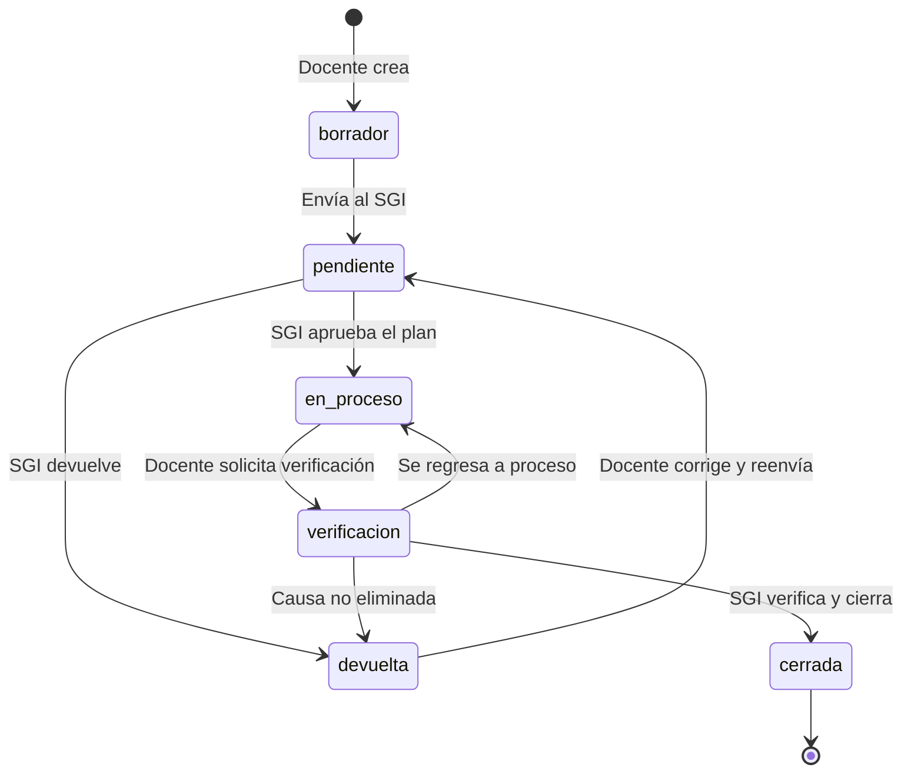

# Requisición de Acciones Correctivas · SGI

Sistema web que digitaliza el formato **ITMORELIA-IT-CA-004-01 «Requisición de Acciones Correctivas»** del Sistema de Gestión Integrado (SGI) del **Instituto Tecnológico de Morelia · TecNM**. Reemplaza el trámite en papel: los docentes registran la requisición, el SGI la revisa, se da seguimiento al plan de acción con evidencias reales y todo termina en una verificación de eficacia con su historial completo.


---

## Contenido

- [Características](#características)
- [Flujo de una requisición](#flujo-de-una-requisición)
- [Roles y permisos](#roles-y-permisos)
- [Tecnologías](#tecnologías)
- [Estructura del repositorio](#estructura-del-repositorio)
- [Puesta en marcha](#puesta-en-marcha)
- [Variables de entorno](#variables-de-entorno)
- [Scripts](#scripts)
- [Seguridad](#seguridad)
- [Evidencias, bitácora, recordatorios y respaldos](#evidencias-bitácora-recordatorios-y-respaldos)
- [Despliegue en producción](#despliegue-en-producción)
- [Limitaciones conocidas](#limitaciones-conocidas)

---

## Características

**Para docentes**
- Captura guiada del formato (solicitud, análisis de causa, plan de acción) con borradores y validación.
- Envío al SGI, corrección de requisiciones devueltas y seguimiento del avance de cada acción.
- Subida real de **evidencias por acción** (PDF, Office, imágenes…), con descarga segura.
- Aviso de acciones vencidas y recordatorios por correo.
- Perfil con **foto**, datos institucionales y cambio de contraseña.

**Para el SGI (administradores)**
- Revisión: aprobar el plan, devolver con comentarios, verificar la eficacia y cerrar.
- Edición de cualquier requisición en cualquier estado (queda en el historial con autor y motivo).
- Tablero y **reportes** con exportación a **CSV** (compatible con Excel).
- Gestión de usuarios y catálogos (departamentos, técnicas estadísticas, responsables).
- **Bitácora de auditoría** de las acciones importantes, con filtros, búsqueda y exportación.
- Panel de acciones vencidas con envío de recordatorios (manual o programado).
- Impresión del formato oficial / PDF desde `Imprimir`.

**Generales**
- Interfaz responsiva (celular y escritorio), modo oscuro y animaciones suaves que respetan «reducir movimiento».
- Registro de cuentas con **verificación de correo** (código de 6 dígitos) y recuperación de contraseña.
- Folios `AC-ITM-AAAA-NNN` consecutivos por año, asignados en el servidor dentro de una transacción.
- Fechas calculadas con la hora de México, no la del servidor.

## Flujo de una requisición



| Estado | Qué se puede hacer |
|---|---|
| **Borrador** | El docente edita libremente. |
| **Pendiente** | Bloqueada: el SGI la revisa. |
| **Devuelta** | El docente corrige y reenvía. |
| **En proceso** | Se marcan acciones, se agregan acciones nuevas y se adjuntan evidencias. |
| **Verificación** | Bloqueada para que el SGI verifique la eficacia. |
| **Cerrada** | Solo lectura (también para evidencias). |

## Roles y permisos

| Rol | Puede |
|---|---|
| **Docente** | Crear y editar borradores, enviar, corregir devueltas, marcar avance, adjuntar evidencias en «en proceso», solicitar verificación y ver **solo lo suyo**. |
| **Administrador (SGI)** | Todo lo anterior sobre cualquier requisición, además de aprobar, devolver, verificar y cerrar, editar en cualquier estado, reportes, usuarios, catálogos y bitácora. |

> Los administradores solo los crea otro administrador. El registro público siempre crea docentes. Un administrador **no** restablece contraseñas ajenas: cada persona usa «Mi perfil» o «Olvidé mi contraseña».

## Tecnologías

| Capa | Herramientas |
|---|---|
| Aplicación | Next.js 16 (App Router), React 19, TypeScript |
| Estilos | Tailwind CSS 4, lucide-react |
| Datos | PostgreSQL 16, Prisma 7 (adaptador `pg`) |
| Autenticación | next-auth v4 (credenciales, sesión JWT de 8 h), bcryptjs |
| Validación | Zod (cliente y servidor) |
| Correo | Nodemailer (SMTP) |

## Estructura del repositorio

La aplicación vive en la carpeta `ss/`; todos los comandos de este README se ejecutan dentro de ella.

```
ServicioSocial/
└── ss/
    ├── app/
    │   ├── api/                 # Rutas del servidor (la autorización real vive aquí)
    │   ├── auth/login/          # Inicio de sesión y registro
    │   ├── dashboard/           # Tablero, requisiciones, reportes, usuarios, catálogos, bitácora, perfil
    │   └── imprimir/[id]/       # Formato imprimible / PDF
    ├── components/              # UI, layout y componentes de requisiciones
    ├── lib/
    │   ├── server/              # Lógica de servidor: actor, requisiciones, evidencias, archivos, auditoría, correo…
    │   ├── validacion.ts        # Esquemas Zod
    │   ├── security.ts          # Política de contraseñas y bcrypt
    │   ├── institucional.ts     # Listas cerradas de departamentos y puestos
    │   └── csv.ts               # Exportación CSV
    ├── prisma/                  # schema.prisma y migraciones
    ├── scripts/                 # Administrador inicial, respaldos, verificación, recordatorios
    ├── proxy.ts                 # Redirecciones por rol y protección CSRF
    └── docker-compose.yml       # PostgreSQL local opcional
```

## Puesta en marcha

Requisitos: **Node.js 20+**, **PostgreSQL 16** (o Docker) y npm.

```bash
cd ss

# 1. Variables de entorno
cp .env.example .env            # y escribe NEXTAUTH_SECRET:  openssl rand -base64 32

# 2. PostgreSQL (opción rápida con Docker; si ya tienes uno, ajusta DATABASE_URL en .env)
docker compose up -d

# 3. Dependencias (también ejecuta «prisma generate»)
npm install

# 4. Crear las tablas
npx prisma migrate dev

# 5. Primer administrador (no hay usuarios de prueba)
npm run db:crear-admin -- --nombre "Nombre Apellido" --correo admin@morelia.tecnm.mx --password "una-contraseña-larga"

# 6. (Opcional) técnicas estadísticas habituales del formato
npm run db:catalogos-base

# 7. Arrancar
npm run dev                     # http://localhost:3000
```

Después entra con el administrador y, en **Usuarios** y **Catálogos**, da de alta a los docentes, departamentos y responsables.

> Sin SMTP configurado, en desarrollo el código de verificación y los correos se imprimen en la terminal de `npm run dev`.

## Variables de entorno

Se copian de `.env.example` a `.env`. **Nunca subas `.env` a git.**

| Variable | Obligatoria | Descripción |
|---|:---:|---|
| `DATABASE_URL` | Sí | Cadena de conexión a PostgreSQL. |
| `NEXTAUTH_URL` | Sí | URL pública de la aplicación. |
| `NEXTAUTH_SECRET` | Sí | Secreto para firmar sesiones (`openssl rand -base64 32`). |
| `REGISTRO_ABIERTO` | No | `false` apaga el registro público. |
| `REGISTRO_DOMINIOS` | No | Dominios de correo permitidos al registrarse (vacío = cualquiera). |
| `SMTP_HOST` `SMTP_PORT` `SMTP_USER` `SMTP_PASS` `SMTP_FROM` | No* | Envío de correos. *Necesario en producción para códigos, recuperación y recordatorios. |
| `ALMACEN_DIR` | No | Carpeta de las evidencias (por defecto `storage/evidencias`). |
| `RESPALDOS_DIR` / `RESPALDOS_CONSERVAR` | No | Carpeta de respaldos y cuántos conservar (14 por defecto). |
| `CRON_SECRET` | No | Mínimo 16 caracteres; permite programar los recordatorios. |
| `RECORDATORIO_DIAS` | No | Cada cuántos días se repite el aviso de una misma requisición (3). |

## Scripts

| Comando | Qué hace |
|---|---|
| `npm run dev` / `build` / `start` | Desarrollo, compilación y producción. |
| `npm run lint` / `typecheck` | ESLint y TypeScript. |
| `npm run db:migrar` | `prisma migrate dev` (desarrollo). |
| `npm run db:desplegar` | `prisma migrate deploy` (producción). |
| `npm run db:estudio` | Prisma Studio. |
| `npm run db:crear-admin` | Crea un administrador (`--nombre`, `--correo`, `--password`). |
| `npm run db:catalogos-base` | Carga técnicas estadísticas habituales. |
| `npm run respaldo` | Respalda base de datos, evidencias y huellas. |
| `npm run restaurar -- respaldos/<carpeta> --confirmar` | Restaura un respaldo. |
| `npm run verificar` | Revisa `.env`, base, almacén y SMTP (`SMTP_PROBAR_A=correo` envía una prueba). |
| `npm run prueba:http` | Prueba la app en marcha con varios usuarios (`PRUEBA_ADMIN_CORREO`, `PRUEBA_ADMIN_PASSWORD`); crea y borra sus propios datos. |
| `npm run recordatorios` | Envía recordatorios de acciones vencidas (para programar una vez al día). |

## Seguridad

- **Autorización en el servidor**: cada ruta de `app/api/**` consulta la base de datos para conocer rol y estado del usuario (`lib/server/actor.ts`); `proxy.ts` solo redirige.
- **CSRF** por verificación de origen en toda la API, cuerpo máximo de 256 KB y respuestas `no-store`.
- **Contraseñas**: mínimo 8 caracteres, letras y números, sin contraseñas comunes ni el correo dentro; bcrypt (costo 12). Al cambiarla se cierran las sesiones anteriores.
- **Límites de intentos**: bloqueo de cuenta (5 fallos / 15 min), límite por IP en login y registro y límite de códigos por correo.
- **Registro verificado**: código de 6 dígitos que vence en 15 minutos, admite 5 intentos, sirve una vez y solo se guarda su HMAC.
- **Archivos**: tipo validado por su contenido real (no por la extensión), nombre aleatorio en disco, huella SHA-256, descarga solo con permiso sobre la requisición y cabeceras `nosniff`. Las fotos de perfil (máx. 2 MB) solo las ven su dueño y los administradores.
- **Listas cerradas**: departamentos y puestos se validan también en el servidor.
- **Cabeceras HTTP**: CSP, X-Frame-Options, nosniff, Referrer-Policy, Permissions-Policy y HSTS (`next.config.ts`).
- Los limitadores viven en memoria: bastan para un solo servidor; con varias instancias hay que moverlos a Redis o a la base de datos.

## Evidencias, bitácora, recordatorios y respaldos

- **Evidencias**: se suben a la acción del plan (o como evidencia general) desde la vista de la requisición, hasta 8 MB. El docente adjunta solo en «en proceso»; el administrador, en cualquier estado salvo cerrada.
- **Bitácora** (`/dashboard/auditoria`, solo administradores): registra únicamente lo importante: envíos, aprobaciones, devoluciones, verificaciones, cierres, ediciones y eliminaciones de requisiciones, altas/ediciones/bajas de usuarios, catálogos, cambios de contraseña, bloqueos de acceso y recordatorios. No guarda inicios de sesión normales ni cada descarga o guardado.
- **Acciones vencidas**: panel en el tablero. El administrador envía recordatorios con un botón o los programa con `CRON_SECRET` + `npm run recordatorios` (una vez al día).
- **Respaldos**: `npm run respaldo` requiere `pg_dump`/`psql` en el equipo (o la base en `docker compose`). Copia la carpeta `respaldos/` a otro disco o a la nube.

## Despliegue en producción

1. Configura `.env` con un `NEXTAUTH_SECRET` propio, `NEXTAUTH_URL` real y **SMTP**.
2. Apunta `ALMACEN_DIR` y `RESPALDOS_DIR` a discos con respaldo.
3. `npm ci && npm run db:desplegar && npm run build && npm start`.
4. Ejecuta `npm run verificar` y programa `npm run recordatorios` y `npm run respaldo` (una vez al día).
5. Sirve la aplicación detrás de HTTPS.

## Limitaciones conocidas

- Los listados cargan todas las requisiciones visibles (sin paginación todavía).
- Los limitadores de intentos son en memoria (ver [Seguridad](#seguridad)).
- Las evidencias se guardan en disco local; para varias instancias se necesitaría almacenamiento compartido (S3 o similar).
- Sin restablecimiento de contraseña por parte del administrador: la recuperación depende del correo (SMTP).

---

Proyecto de **Servicio Social** · Instituto Tecnológico de Morelia · Sistema de Gestión Integrado.
